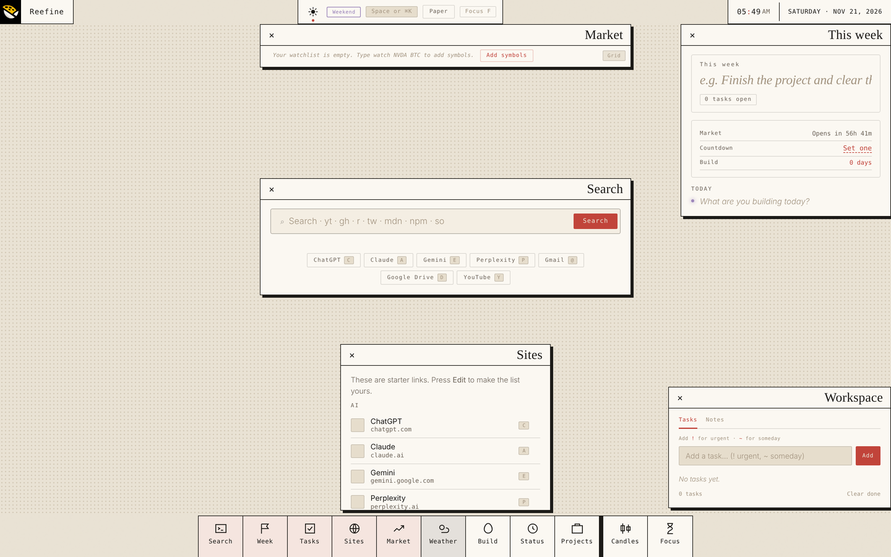

# Reefine: Command Center

A browser start page that works like a small desktop. It has a command bar in the middle, windows you can drag around, a dock along the bottom, and a second screen of daily brain games below.

**Live:** https://cc16-tech.github.io/ff-homepage/

It's one HTML file with no framework, no build step and no account. Everything you type is stored in your own browser and is never sent anywhere.

## What it does

| | |
|---|---|
| **Command bar** | Press `Space` or `⌘K` and type. Examples: `todo call the bank`, `= 1200*1.0725`, `sep 15 dentist`, `$NVDA`, `weather`, `tidy` |
| **Windows** | Search, This week, Workspace (tasks and notes), Sites, Market, Weather, Build streak, Status and Projects. Open them from the dock and drag them by the title bar. Each one reopens where you left it. Search always starts in the centre. |
| **Themes** | Paper, Newsprint and Terminal (`T`). Each has its own typefaces. |
| **Light** | Morning, Noon or Night. It follows your clock by default. Hover over the icon by the time badge to pick one yourself. |
| **Brain games** | Scroll down for Chess.com, Wordle, Nitro Type, Sporcle and Krillion. |
| **Focus mode** | `F` hides everything except a Pomodoro timer and today's focus. |
| **Market** | A live watchlist ticker, plus paper trades with `buy SYM qty` and `close SYM`. |
| **Build streak** | Log what you shipped each day. A few things stay hidden until you find them. |
| **Offline** | After the first visit it still loads without a connection, using a service worker. |

## Make it yours

Nothing personal ships with the page. Each visitor sets up their own:

| | |
|---|---|
| **Links** | Open **Sites → Edit** to add, remove or group links. Give a link a one-letter key and `g` + that letter opens it. You start with a few general links. |
| **Watchlist** | Type `watch NVDA SPY BTC` or `unwatch TSLA`. Common cryptocurrencies are detected automatically. |
| **Countdown** | Type `countdown dec 18 Graduation`, or any date and name: a birthday, a trip, a launch. Type `countdown off` to clear it. |
| **Everything else** | Open **Settings** by clicking the version label at the bottom right. |

## Keyboard

| Key | Action |
|---|---|
| `Space` / `⌘K` | Command bar |
| `g` then a letter | Open one of your links |
| `T` / `Shift+T` | Next theme / next light |
| `F` | Focus mode |
| `?` | All shortcuts |
| `Esc` | Close whatever is open |

## Use it as your Firefox home page

1. Go to **Settings → Home → Homepage and new windows → Custom URLs** and paste the live link.
2. To get it on new tabs too, install a new-tab add-on that redirects to a URL, such as *New Tab URL*, and give it the same link.

## Your data

Tasks, notes, streaks, window positions and settings live in your browser's IndexedDB. Clearing site data wipes them, so use **Settings → Export** to make a backup. A new visitor always starts with an empty page.

## Files

| File | Purpose |
|---|---|
| `index.html` | The whole app |
| `sw.js` | Service worker for offline use |
| `reefine-logo.png`, `favicon.png` | Reefine logo and tab icon |
| `screenshot.png` | The image at the top of this README |

## Version history

| Version | Date | Highlights |
|---|---|---|
| v7.1 | Nov 2026 | Your own links, watchlist and countdown, set from the page. The public file ships with none. Renamed to Reefine |
| v7.0 | Nov 2026 | Redesigned as a desk with windows and a dock. Added the brain games screen, Morning/Noon/Night light, typefaces per theme and the Reefine logo |
| v6.5 | Nov 2026 | Paper, Newsprint and Terminal themes; command bar; Candles mini-game; build streak; calendar; offline support; paper trades |
| v6.2 | Mar 2026 | Command Center with a ticker, workspace and site sections |
| v5.x | Mar 2026 | CC OS and Command Center v5.1 |
| v1 to v4 | Mar 2026 | The Starting Zone: the first versions |

---

Built by Cristian Calix · Reefine
